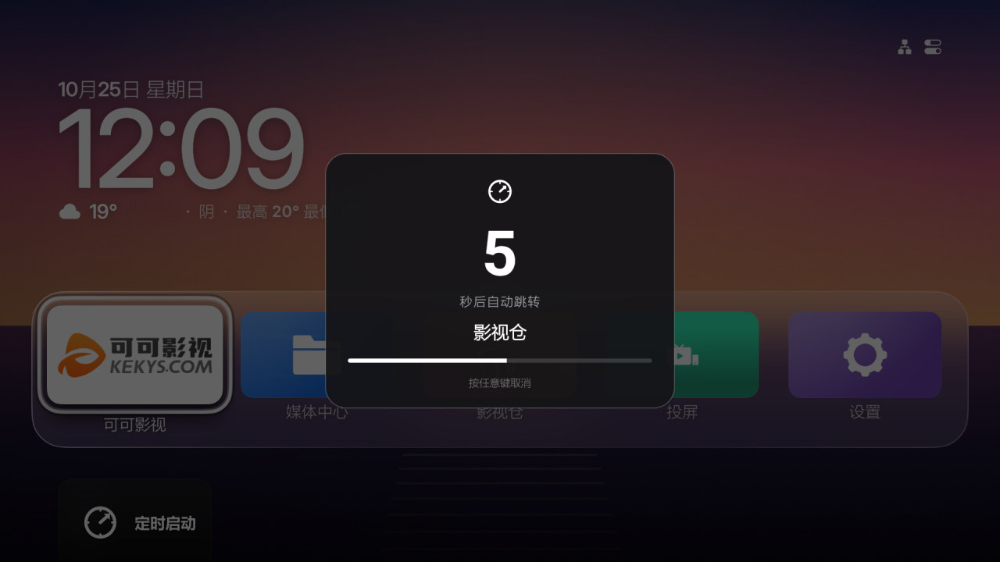
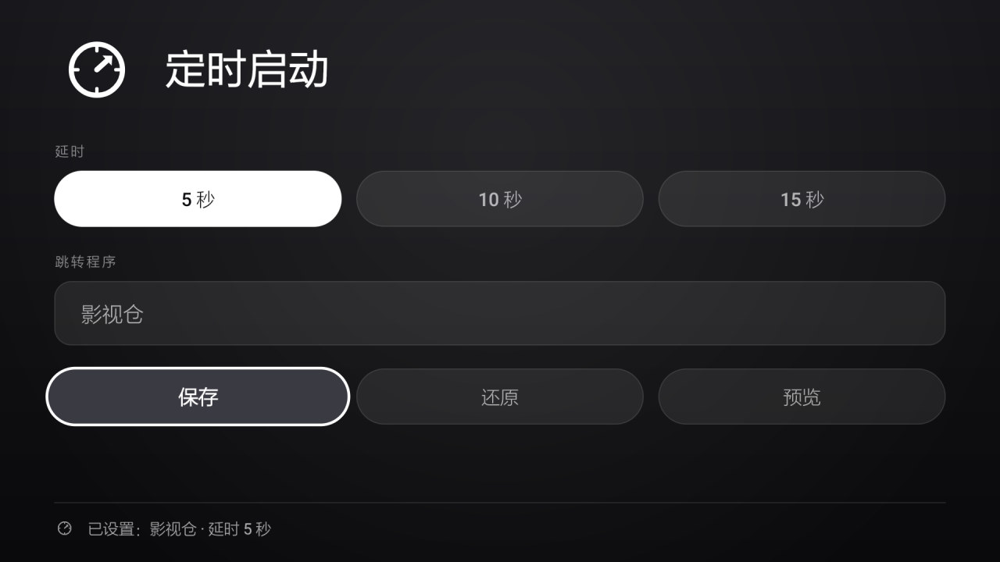

# 让老人开机就能看直播：创维小湃 P3 电视盒子改造

把一台 2019 年的封闭安卓电视盒子（**创维小湃 P3 / Q5001，Android 10**），改造成开机自动进
Aerial 桌面、几秒后自动跳转直播软件的样子。**全程免 root、只用 ADB、所有改动可一键还原。**


---

## 缘起

这个项目的起点很朴素：**家里老人只想打开电视就能看到直播。**

这台创维小湃 P3 是几年前的老盒子——开机先看一段广告，主页给的是付费点播入口，
遥控器按错两下就回不来了。我想把它改到"按下电源键，几秒后直播自己出来"的程度，
中间不需要任何人做选择。

真正的转折点是看到 [CleanYourTV](https://github.com/Gathin23/cleanyourtv)：它证明了这类封闭
固件其实留了一道缝——**HOME 解析用的是包名前缀白名单**，只要把桌面包名改成白名单前缀，
系统就认。顺着这条线索，桌面换成了 [Aerial TV](https://github.com/pengchujin/aerial-tv)
（一个仿 Apple TV 风格的开源电视桌面），再补一个小应用，负责开机后把人送到直播软件里。

整个过程是跟 AI 编程工具 **WorkBuddy** 一起磨出来的：读系统状态、试错、写脚本、改源码、
编译、装机、看 logcat 复盘。仓库里留下的是结果——一套能照着复现的脚本和文档，
而不只是几张效果图。

> 这台盒子的固件封得比想象中死：不给 root、不让第三方桌面当 HOME、连第三方应用的开机广播
> 都拦。所以下面所有方案都不是"标准做法"，而是针对这台机器的实测结论，**换机型请先跑体检脚本**。

---

## 最终效果

| 定时提醒浮层（倒计时 9 秒） | 设置界面 |
|---|---|
|  |  |

1. 通电开机 → 自动进入 Aerial 桌面（航拍壁纸 + 时钟 + 天气 + 应用图块）
2. 进桌面 5 秒（可设 5/10/15）→ 弹出提醒浮层，**倒计时 9 秒**
3. 倒计时结束 → 自动跳到预设应用（这里是"影视仓"）
4. **浮层出现后按遥控器任意键 → 取消跳转**，留在桌面自己选

从桌面画出来到浮层弹出约 9 秒（实测：arm 后精确 6.0 秒）；按任意键取消是即时生效的。

---

## 这台盒子

同型号参数基本一致，详细采集结果见 [docs/06-硬件信息.md](docs/06-硬件信息.md)。

| 项目 | 值 |
|---|---|
| 型号 | 创维小湃 P3（Q5001 / cupid-p2） |
| 系统 | Android 10（API 29），内核 4.9.170，安全补丁 2019-12 |
| SoC / GPU | 全志 H616（四核 A53 @1.512GHz）/ Mali-G31 |
| 内存 / 存储 | 2 GB / 16 GB eMMC（`/data` 约 12 G） |
| 输出 | 1920×1080 @ 50Hz |
| 网络 | 百兆有线（eth0），支持 Wi-Fi |
| 用户空间 | **32 位**（`armeabi-v7a`），纯 64 位 so 的应用装不上 |
| root | **不可用**（`adbd can't run as root`，无 su，`/system` 只读） |
| 可用的权限 | `pm disable-user`、`cmd package set-home-activity`、`settings put` |

2 GB 内存 + 百兆网口是这台机器的天花板，所以后面所有优化都围绕**省内存、少常驻、少动画**来做。

---

## 改造路线（给要动手的人）

七个阶段，前两步是准备，中间四步是主体，最后一步是保险。每一步的取舍和失败尝试都写在
[docs/00-改造全过程.md](docs/00-改造全过程.md) 里。

| # | 阶段 | 关键动作 | 成败要点 |
|---|---|---|---|
| 0 | **判断值不值得动** | 查 `ro.product.cpu.abi`、`getprop ro.serialno`、能否开 ADB | 64 位设备、有 ADB 就都能做 |
| 1 | **开 ADB** | 设置 → 关于 → 连点版本号 → 开发者选项 → 网络调试 | 记下 IP，`adb connect IP:5555` |
| 2 | **体检** | `./scripts/00-doctor.sh` | 先摸清跑了什么、能停什么，别一上来就删 |
| 3 | **系统瘦身** | `./scripts/10-optimize.sh`：停 18 个常驻、调 6 项参数、换屏保、清缓存 | 只动系统应用，第三方一律不碰 |
| 4 | **换桌面** | 改 `applicationId` 成白名单前缀 → 编译 → 装 → `set-home-activity` | **整件事的核心，见下方"坑 1"** |
| 5 | **开机自启** | 桌面首次启动时显式 `startForegroundService` 拉起自己的服务 | **固件拦一切第三方开机广播，见"坑 2"** |
| 6 | **细节调优** | 固定天气城市、换掉广告屏保、统一 logo、把倒计时压到 9 秒 | 都是"不影响功能但影响体感"的部分 |
| 7 | **留好回滚** | 参数原值、停用清单、屏保原值全部落盘；`./scripts/40-restore.sh` | 装完先跑一次还原验证可行性 |

---

## 这套东西解决的两个坑

### 坑 1：HOME 白名单（第三方桌面装了也选不了）

系统在 framework 层过滤 HOME 候选，日志关键字 `PackageManager: block home apk` / `allow home apk`。
白名单是**前缀匹配**：

```
com.skyworthdigital.sky2dlauncher
com.ktcp.launcher            ← 系统里根本没有这个包，但前缀被放行
com.android.provision
com.skyworthdigital.bluetooth.settings
```

**解法**：把桌面 APK 的 `applicationId` 改成 `com.ktcp.launcher.XXX`（子前缀即可，不用抢本体）。
`settings global enable_launcher_components` 和 `setprop sys.launcherlist.enable 0` 都**无效**
（开机被系统服务重置），别浪费时间。

> 改 `applicationId` 不影响代码：Java 命名空间保持原样，只是组件全名变成
> `com.ktcp.launcher.aerial/app.orchard.tv.MainActivity` 这种混合形式。

### 坑 2：第三方应用的开机广播全被拦（自启无门）

```
E BroadcastQueue: Block auto start app from broadcast: <pkg>
```

已验证**无效**的路子：BOOT_COMPLETED receiver、加 `enable_running_backgroud_components` 白名单、
借白名单里的空包名、`monkey` 清 stopped 态、前台服务自救。连预装的搜狗输入法都被拦。

**解法**：让**桌面**在开机首次启动时显式拉起定时启动的服务。桌面本来就一定会跑，
而"前台应用显式 startService"是这套固件唯一放行的自启方式。
Aerial 自带 `firstStartSinceBoot()`（用 `Settings.Global.BOOT_COUNT` 去重），
在它后面挂一个 `AutostartBridge`（见 `patches/aerial-tv-p3.patch`）。

> 补充：`BOOT_COMPLETED` 并非永远收不到——包处于非 stopped 态时确实会派发。
> 所以定时启动里对"被 arm 两次"做了幂等（只认第一次），否则第二次会用更晚的计时覆盖第一次，
> 白白多等十几秒。

---

## 目录结构

```
skyworth-p3-launcher-kit/
├── README.md                 本文件
├── CHANGELOG.md              版本记录（含每次踩坑的现场分析）
├── docs/
│   ├── 00-改造全过程.md       从零到可用的完整历程：决策、失败尝试、时间线
│   ├── 01-环境准备.md
│   ├── 02-体检与系统优化.md
│   ├── 03-Aerial桌面部署.md
│   ├── 04-定时启动部署.md
│   ├── 05-故障排查.md
│   ├── 06-硬件信息.md
│   ├── 07-备份到GitHub.md
│   └── html/                四份可直接打开的图文报告
├── scripts/                  所有操作都在这里，按编号顺序跑
│   ├── lib.sh                公共库（ADB 连接/地址/常量）
│   ├── box.conf              盒子 IP（改成你自己的）
│   ├── 01-setup-env.sh       环境自检
│   ├── 00-doctor.sh          体检，输出一份现状报告（只读）
│   ├── 10-optimize.sh        系统优化（停用清单、调参、换屏保、清垃圾）
│   ├── 20-build-autostart.sh 编译安装「定时启动」
│   ├── 21-build-aerial.sh    clone 上游 → 打补丁 → 编译 → 安装 → 设为 HOME
│   ├── 30-set-autostart.sh   设置跳转目标与延迟
│   ├── 31-set-weather.sh     设置天气城市
│   ├── 40-restore.sh         一键还原
│   ├── 99-deploy-all.sh      一键全流程
│   └── 50-backup-github.sh   把整套东西备份到 GitHub（SSH 免密 / zip）
├── apps/TVAutoStart/         「定时启动」完整源码（纯框架 API，无三方依赖）
├── patches/aerial-tv-p3.patch  Aerial 桌面的三处改动（不复制上游 96MB 源码）
├── apk/                      编译好的 APK：Aerial 1.49、定时启动 v4.2，不想编译直接装
├── tools/                    logo 生成、天气二维码解码、截图脱敏
├── config/                   停用清单、屏保原值备份
└── assets/screenshots/       效果截图（已脱敏）
```

---

## 快速开始

### A. 只想装上用（最快，5 分钟）

```bash
# 1. 填地址（脚本里的默认值是示例，必须改）
vi scripts/box.conf          # BOX_TARGET=192.168.1.100:5555

# 2. 自检（会告诉你缺什么）
./scripts/01-setup-env.sh

# 3. 一键部署，顺带把跳转目标设成影视仓、进桌面 5 秒后提醒
./scripts/99-deploy-all.sh com.huawei.himovceie 影视仓 5
```

### B. 从源码编译

```bash
export ANDROID_HOME=/path/to/android-sdk     # 需要 platforms;android-36 + build-tools;35.0.0
./scripts/99-deploy-all.sh --build com.huawei.himovceie 影视仓 5
```

### C. 只装其中一个

```bash
./scripts/21-build-aerial.sh --apk       # 只装 Aerial 桌面并设为 HOME
./scripts/20-build-autostart.sh --apk    # 只装定时启动
./scripts/30-set-autostart.sh --list     # 看看能跳哪些应用
./scripts/10-optimize.sh                 # 只做系统优化
```

### 回滚

```bash
./scripts/40-restore.sh              # 全部还原（参数 + 应用 + 官方桌面）
./scripts/40-restore.sh --uninstall  # 卸掉我们装的两个应用
```

---

## 几个必须知道的注意事项

| 事项 | 说明 |
|---|---|
| **别用 Aerial 的「检查更新」** | 它下载官方 `app.orchard.tv` 包，会装成第二个应用。升级就重跑 `21-build-aerial.sh` |
| **屏保重启后会变回广告** | 固件每次开机把 `screensaver_components` 写回创维广告组件。跑 `./scripts/10-optimize.sh` 补回 |
| **编译必须带包名参数** | `./gradlew assembleRelease -PlauncherApplicationId=com.ktcp.launcher.autostart` |
| **侧装后要清 stopped 态** | `monkey -p <pkg> -c android.intent.category.LAUNCHER 1`，脚本已包含 |
| **盒子会休眠** | 休眠后 ADB 无响应，需要遥控器唤醒。不是脚本出错 |
| **卸载官方桌面有风险** | 只在第三方桌面已接管后停用，`10-optimize.sh` 默认跳过 |
| **改设置页的"还原"是清空配置** | 不是关掉功能开关，点完就回到"未设置"状态 |
| **Git Bash 环境** | adb daemon 每条命令结束会被清掉，脚本已每次重连；`adb pull` 要 `MSYS_NO_PATHCONV=1` |

---

## 关于隐私：仓库里隐去了什么

这是从**真实在用的设备**上整理出来的记录，公开发布前做了脱敏：

| 信息 | 处理 |
|---|---|
| 设备序列号 | 隐去（`docs/06` 只留字段名和读取命令） |
| MAC 地址（eth0 / wlan0 / p2p0） | 换成 `00:11:22:33:44:xx` 示意值 |
| 局域网 IP | 换成 `192.168.1.100` 示例，脚本读取 `scripts/box.conf` |
| 常用城市（天气） | 文档与脚本示例统一用「北京市」，截图里的城市名用 inpaint 重建背景抹掉 |
| 本机路径、账号、token | 全部不出现 |

截图脱敏用的是 `tools/redact_screenshot.py`（OpenCV inpaint）——在渐变壁纸上
重建出来的背景既没有边界线也没有色块，看不出涂改痕迹。你要分享自己的截图也可以用它。

**你在自己设备上得到的序列号、MAC、IP 不会出现在这里；也请不要把它们贴进 issue。**

---

## 备份到 GitHub

仓库在 <https://github.com/JohnnyLong2026/skyworthbox-p3-launcher-kit>。

```bash
cd scripts
./50-backup-github.sh          # 走 SSH 推送，免密
./50-backup-github.sh --zip    # 或只打包成 zip，网页手动传
```

要用你自己的仓库，改脚本里的 `REPO_NAME` 和推送地址即可（现在写的是本仓库的名字）。
SSH 公钥只登记一次就一直有效；没登记时脚本会把公钥打出来并告诉你去哪儿加。
完整流程见 [docs/07-备份到GitHub.md](docs/07-备份到GitHub.md)。

---

## 上游与许可

- 灵感来源：[Gathin23/cleanyourtv](https://github.com/Gathin23/cleanyourtv)
- Aerial 桌面：[pengchujin/aerial-tv](https://github.com/pengchujin/aerial-tv)（Apache-2.0），本仓库只保留改动补丁
- 「定时启动」为本仓库自研，MIT

盒子端的所有操作都是 ADB 标准命令，不修改系统分区、不刷机，不影响保修所需的系统完整性。
按本文档操作造成的任何后果请自行承担——尤其是 `pm disable-user` 和停用官方桌面这两步。
