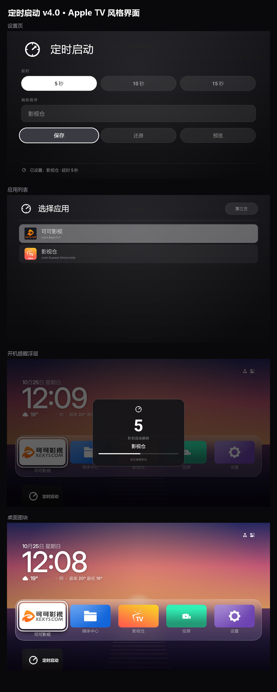

# 04 定时启动部署

「定时启动」是本仓库自研的小应用（源码 `apps/TVAutoStart/`，纯框架 API，APK 只有 121KB）。



## 行为

进桌面 N 秒（5/10/15 可选）→ 弹出提醒浮层 → 浮层内倒计时 **9 秒** → 跳转目标应用；
**浮层出现后按遥控器任意键即取消**，留在桌面。

## 安装

```bash
./scripts/20-build-autostart.sh --apk     # 装现成 APK
./scripts/20-build-autostart.sh           # 从源码编译后安装
```

**编译必须带包名参数**，否则会装成另一个包：

```bash
cd apps/TVAutoStart
./gradlew assembleRelease -PlauncherApplicationId=com.ktcp.launcher.autostart
```

## 设置跳转目标

```bash
./scripts/30-set-autostart.sh --list                          # 列出可选应用
./scripts/30-set-autostart.sh com.huawei.himovceie 影视仓 5    # 设置
./scripts/30-set-autostart.sh --status                        # 查看当前配置
./scripts/30-set-autostart.sh --reset                         # 还原（清空，开机不跳转）
```

也可以在盒子上打开「定时启动」用遥控器设置（Apple TV 风格界面）：

- 跳转程序：点「选择应用」，只列有启动入口的第三方应用
- 延迟：5 / 10 / 15 秒胶囊三选一
- **还原**：清空已设的跳转程序和延迟

## 架构

```
Aerial 桌面（开机首次启动）                      BootReceiver
        │  AutostartBridge.armOncePerBoot()          │  BOOT_COMPLETED（固件常拦，偶尔放行）
        │  startForegroundService(ACTION_ARM)        │  带 ACTION_ARM + 显式 waitMs
        └──────────────────┬──────────────────────────┘
                           ▼
        ReminderService（前台服务，等 N 秒；一次开机只认第一次 arm）
                           ▼
        ReminderActivity（透明浮层，倒计时 9 秒）
                ├─ 倒计时结束 → startActivity(目标应用)
                └─ onKeyDown 任意键 → finish() 取消
```

配置存在 `SharedPreferences`（`Prefs.java`：delay / pkg / armed）。

**时序（实测）**：桌面可见 → 约 2.9 秒后 arm（Aerial 完成首次组合）→ 1 秒缓冲 + 用户延迟 →
浮层出现。默认 5 秒延迟时，进桌面约 9 秒弹窗。

> 计时用「绝对死线 + 250ms 轮询自校正」，不用单发 `postDelayed`：刚开机的盒子主线程很忙，
> 一次性定时器会迟到好几秒（见过 23.8 秒的事件）。v4.2 起还加了幂等保护，
> 两条 arm 路径同时触发时后到的那个会被忽略，不会重设倒计时。

> **arm 只能由桌面发起**：`MainActivity`（设置界面）不参与 arm，且打开它会 `stopService`
> 取消掉还没弹出的那次跳转（写在 `onResume()`，因为 singleTask 的界面再打开走 `onNewIntent()`
> 不进 `onCreate()`）。详见 CHANGELOG 里的 v4.1 修复说明。

## 源码结构

| 文件 | 作用 |
|---|---|
| `MainActivity.java` | Apple TV 风格设置界面；处理 `setup_pkg/setup_label/setup_delay` 注入 |
| `AppPickerActivity.java` | 应用选择列表（只列有启动入口的第三方应用，排除声明 HOME 的） |
| `ReminderService.java` | 前台服务，等待指定时长后拉起浮层；`exported=true` 接收桌面的 `ACTION_ARM` |
| `ReminderActivity.java` | 浮层与倒计时（`NOTICE_SECONDS = 9`），吞掉所有按键 |
| `Prefs.java` | 配置读写 |
| `BootReceiver.java` | 保留的标准开机广播（这台机器上会被固件拦，靠桌面桥接兜底） |

## 改倒计时长

`ReminderActivity.java` 顶部：

```java
private static final int NOTICE_SECONDS = 9;
```

## 界面风格（Apple TV）

- 近黑画布 `#17171B → #0A0A0C`，纯白单强调色，胶囊控件，聚焦 `scale 1.06`（`res/animator/focus_lift.xml`）
- **ListView 的行拿不到 `state_focused`**（ListView 自己持有焦点），
  高亮必须用 `android:listSelector`（`res/drawable/bg_list_selector.xml`），不能靠行背景 selector
- 盒子 320dpi，逻辑分辨率 960×540dp，布局按这个预算排（浮层宽 336dp ≈ 屏宽 34%）

## logo

`tools/make_logo_white.py` 生成白色圆环 + 环内箭头的标志（位图与矢量 `res/drawable/ic_alarm.xml` 同源）：

```bash
pip install pillow
python tools/make_logo_white.py
```

两个已踩的坑：

- 矢量圆环**不能用退化弧**（`a14.4,14.4 0 1,0 0.001,0` 会被 Android 路径解析丢掉），
  必须写两段半圆弧：`M9.6,24 A14.4,14.4 0 0,1 38.4,24 A14.4,14.4 0 0,1 9.6,24`
- 箭头要**完全收在环内**，穿出环外会和圆环粘连，48px 下糊成一团
